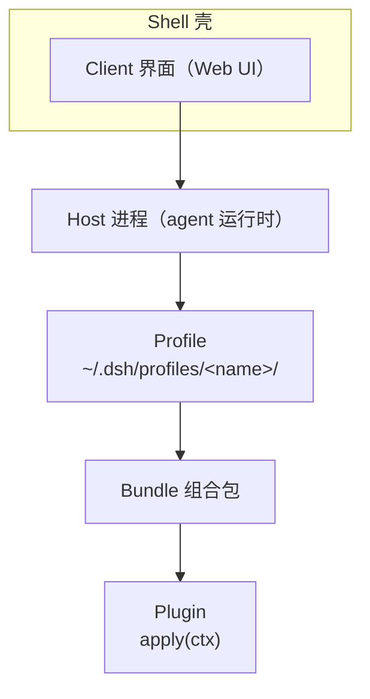

---
tags:
  - 技术
series: Hello World
---
这是我第一次深入体验和研究一款AI Agent，相比之下过往使用Claude等工具的经历只算是浅尝辄止。当然，这脱不开只有DSH完整开源的关系。
## Introduce
DSH全称为DeepSeek Harness，是Deep Seek推出的一套面向编程和自动化的AI  Harness。其源码库[^1]的简介里赫然写着： **"DeepSeek Harness: Everything is a Plugin."**。这个Slogan非常贴合DSH的架构设计理念，在深入DSH架构后会愈发为此震撼。

## CookBook
### 架构
DSH架构是使用统一的`dsh`作为运行内核，然后将**Web**、**Desktop**等模式作为交互的壳，看起来就像TUI那样。大概框架如下图：


DSH的管理模式有点类似**conda**，`Pofile`是`dsh`的配置文件，每个`dsh`命令都会启动一个独立的“空间”，可以配置独立的插件、设置等。配置目录形态如下：

```
~/.dsh/
├── profiles/
│   ├── desktop/          # 桌面应用
│   │   ├── package.json      # 依赖配置 Dependencies+bundles
│   │   ├── node_modules/     # 使用的第三方依赖
│   │   ├── cordis.patch.yml  # 用户自己的覆盖层
│   │   └── pnpm-workspace.yaml
│   └── web/              # Web UI
│   ├── ...        # 其他壳应用
├── sessions/
└── storages/
```

## CLI
运行相关：

插件相关：

## Extension

### Skill
#### Introduce
A/对Skill的官方定义是 **“Skills are folders that include instructions, scripts, and resources that Claude can load when needed.”** 。即一个用于教AI某类任务怎么做的规范。

一般是一个包含 `SKILL.md` 和其他脚本、参考资料的文件夹。其中，Markdown是核心，规范了这类任务的处理流程。

Skill是为了解决两个主要问题：
1. 上下文有限
2. 规范执行流程
上下文有限是不能把所有的skill都写入 **System Prompt** 之中，否则会容易超出对话上下文。后者就是规范化AI在处理某类指定任务，比如AI具有某项MCP赋予的能力后，通常需要Skill使AI学会如何流程化使用该工具。

Skill的做法本质就是提示词工程的一种，将特定提示词抽象出来，以便在命中时触发。这其实和程序设计中的类和函数的抽象一样，就是为了复用功能。提示词工程里对Skill这类做法还有一个术语描述——**progressive disclosure**，**渐进式披露**。

既然是渐进式，所以skills也是不建议安装太多，不然扫目录就占token，匹配也会困难。

#### Management
skill的配置层级也是本地覆盖的类型。`.agents/skills`相当于是一个通用配置，而`.dsh/skills`就是针对DSH的特定配置。常见的Skill管理模式如下：

| 优先级 | 路径                     | 作用域    |
| --- | ---------------------- | ------ |
| 100 | `<项目根>/.dsh/skills`    | 只对这个项目 |
| 200 | `<项目根>/.agents/skills` | 同上     |
| 300 | 配置里的 `customSkillDirs` | 自定义    |
| 400 | `~/.dsh/skills`        | 你的所有项目 |
| 500 | `~/.agents/skills`     | 同上     |

注意：**skill 不按 profile 分家**。桌面版和 web 版看到的是同一份 `~/.dsh/skills`。
但是Skill一般多且杂，MCP也是。brew之类的CLI用久了，就期待有没有什么工具能像包管理器那样管理skills。有的兄弟，有的；Vercel Labs已经把这事给办了（嗨，没赶上🫠）。

**skills**[^3]是基于npx的skills管理器，支持`find`和`install`，对skills来说完全够用了。常用语法如下：

```bash
npx skills add <owner>/<repo>        # 装一个技能包
npx skills find [关键词]              # 搜索
npx skills list                      # 列出已装
npx skills check                     # 检查更新
npx skills update                    # 更新
npx skills remove                    # 卸载
npx skills use <source>@<skill>      # 不安装，直接用一次
npx skills init <name>               # 生成技能模板
```

`npx skills` 目前不支持DSH，因此只能全局安装skills并在DSH中导入或使用插件。
我装了`dsh-skill-mcp-panel`插件来可视化管理当前DSH的Skill和MCP。这个插件也有提供了CLI来管理工作区内的skills，常用命令如下：

``` bash
# 在.zshrc中添加别名
alias dshpanel='node ~/.dsh/profiles/desktop/node_modules/dsh-skill-mcp-panel/lib/cli.js'

dshpanel skill list                    # 看现有（你现在是空的）
dshpanel skill add <路径>              # 装：.md / .zip / 技能文件夹 / 含多个技能的文件夹
dshpanel skill enable <name>           # 启用
dshpanel skill disable <name>          # 停用（改名为 SKILL.md.disabled，热生效）
dshpanel skill delete <name>           # 删除
dshpanel skill scope <name> --workspace <路径>   # 从全局迁到某个项目
```

两者结合起来应该完全够用了，AI建议的使用流程如下：

``` bash
# 装到全局（所有项目可用）
npx skills add vercel-labs/agent-skills -g

# 装到某个项目（优先级更高，跟着仓库走）
cd ~/Workspace/Personal/GameDev/snow-king-shock/SnowKingShock
npx skills add <owner>/<repo> --skill unity-csharp-conventions

# 验证 DSH 能不能看到
dshpanel skill list

# 临时停用某个
dshpanel skill disable unity-csharp-conventions
```

~~我是认为用`npx`的CLI统一管理已经足够，具体工作区可以直接让agent拷贝，或者使用`yazi`手动拷贝，也很快。~~ 不太够，因为 `npx skills`不支持DSH，所以还得倒一次手。

### MCP

#### Introduce
MCP全称 **Model Context Protocol**，是一个开放协议：把外部工具与数据源包成一个个“工具”，让模型像调用原生工具一样调用它们。和Skill最大的区别在于——Skill是往上下文里塞**说明书**，MCP是给模型接**能干活的手**。

MCP服务器是一个独立进程或远端端点，有两种接入方式：本地程序走 `stdio`，远端服务走 `streamable-http`（DSH 官方 SDK 优先协商 2026-07-28 版协议，失败再回落到旧版）。

使用起来和Skill的明显差异有以下两点：

- **工具定义常驻上下文**：Skill 只常驻 `name + description`，命中才读正文；而MCP 的每个工具定义开服时就要全部塞进去。所以MCP装多了，是每一轮对话都在付费。
- **能力边界更大，风险也更大**：它真的能读文件、发网络请求、执行代码。DSH 只校验配置格式，不验证服务器做了什么——装之前得自己看一眼来源。

DSH 里的MCP由 `@deepseek-ai/dsh-mcp-client` 这个插件承担，每台服务器一个实例。暴露给模型的工具名固定是 `mcp__<serverName>__<tool>`，和 Claude Code、Codex 是同一套命名约定，好处是会话历史和权限规则在重启、热重载之后依然有效。

#### Management
 DSH中对MCP的配置管理在 profile 的 `cordis.patch.yml` 里，常用字段如下：

| 字段 | 默认值 | 说明 |
| --- | --- | --- |
| `serverName` | 必填 | `[A-Za-z0-9_-]{1,32}`，同一作用域内唯一；它就是工具名里的 namespace |
| `transport` | 必填 | `stdio` 或 `streamable-http` |
| `command` / `args` / `env` / `cwd` | — | stdio 专用：可执行文件、参数、额外环境变量、工作目录 |
| `url` / `headers` | — | streamable-http 专用：端点地址与额外请求头 |
| `toolCallTimeoutMs` | `60000` | 单次 `tools/call` 或资源请求的超时 |
| `failOnStartupError` | `false` | 初始连接失败时是否拒绝插件激活；`false` 只是工具不出现并记一条错误，harness 照常启动 |
| `reconnect.enabled` | `true` | 断线后自动重连 |
| `reconnect.initialDelayMs` / `maxDelayMs` / `maxAttempts` | `500` / `30000` / `10` | 指数退避重连；连续失败 10 次后该服务器的工具被移除，直到重载配置 |

对于DSH中的MCP，我使用`@dsh-skill-mcp-panel`面板插件进行管理：

``` bash
dshpanel mcp list --profile desktop                 # 看现有

# 本地程序：npx 拉一个官方 server
dshpanel mcp add --name github --stdio \
  --command npx --args -y --args @modelcontextprotocol/server-github \
  --env GITHUB_TOKEN='${GITHUB_TOKEN}' --profile desktop

# 远端服务：Unity 编辑器在 8080 起的 MCP 端点
dshpanel mcp add --name unity --http \
  --url http://localhost:8080/mcp --profile desktop

dshpanel mcp test unity --profile desktop           # 探活
dshpanel mcp disable unity --profile desktop        # 停用（保留配置）
dshpanel mcp remove unity --profile desktop         # 连配置一起删
dshpanel mcp oauth <name> --profile desktop         # 给 streamable-http 做 OAuth 登录
```

几个要留意的点：

1. `--env` / `--header` 里写 `${NAME}`，保存时会存成 `!!js` 表达式、装载时才求值，密钥不会明文躺在配置文件里。
2. 改配置是**原地热重载**那一台服务器，没动过的 `serverName` 不受影响，已加载的工具名也不变。
3. **停用不等于删除**。`disable` 只是标记 `disabled: true`，排查问题时先 disable 比 remove 稳妥。
4. 服务器没起来时（比如 Unity 没开）状态是 `disconnected`，工具调用会失败；把 `failOnStartupError` 设成 `true` 才能让这种情况直接拒绝启动。

### Skill V.S. MCP
MCP和Skill对比如下：

|       | MCP              | Skill                         |
| ----- | ---------------- | ----------------------------- |
| 本质    | 协议，连接外部工具和数据     | 指令 + 资源，教方法                   |
| 形态    | 一个服务器进程          | 一个文件夹                         |
| 运行时   | 独立进程，能读文件、发网络请求  | 纯文本，注入上下文                     |
| 加载方式  | 启动时发现工具，工具定义常驻   | 只加载 name + description，命中才读正文 |
| 谁来做   | 通常第三方提供          | 通常你自己或团队写                     |
| 风险    | **高**：能执行代码、访问数据 | **低**：本质是提示词；带脚本时才有执行         |
| 解决的问题 | “它能不能做这件事”       | “它做得对不对、合不合你的规范”              |
Skill和MCP的区别可以概括为：**MCP 扩展AI“能力边界”，Skill 扩展AI“行为规范”**。

## My Workflow
DSH不算是一款开箱即用的Agent，给我的感觉其实很割裂，和CodeX、Claude等对比更是如此。不支持`homebrew`安装，`npm`安装则无法用CLI管理desktop、插件市场需要自己提供”菜单“等等。初步配置好环境后，体验终于流畅了。给我的感受好似经典梗图——“原来还要自己拼”。不过这种玩法门槛高，上限也高。我似乎在DSH上看到了无穷的潜力。

#### Extensions
我当前使用了如下插件：

1. [dshmarket](https://github.com/dsh-market/dsh-market)：可视化插件市场，在 DSH 里浏览、搜索并一键安装社区插件
2. [dsh-skill-mcp-panel](https://github.com/Fishquito7/dsh-skill-mcp-panel)：在侧栏统一管理 skills 与 MCP 服务器，另带本地 `dsh-panel` CLI
3. [dsh-better-sidebar](https://github.com/omdsh-dev/DSH-better-sidebar)：每个会话独立的侧栏，文件树、编辑器、变更、任务、旁聊收在一列
4. [dsh-cost-meter](https://github.com/Han-1413141/dsh-cost-meter)：会话费用统计，本会话成本、当日费用、历史记录，内置 170+ 模型的价目表
5. [dsh-drawai](https://github.com/fourzkw/dsh-drawai)：右侧栏可编辑画布 + AI 语义绘图，直接读写原生 `.drawio` 文件
6. [billion-context](https://github.com/ranxianglei/billion-context)：上下文压缩，小窗口也能跑长会话，号称省 5 倍 token
7. [dsh-agent-persona](https://github.com/Awoodwhale/dsh-agent-persona)：按工作区路径或会话 ID 绑定 system prompt 人格
8. [dsh-archive-manager](https://github.com/MichengAI/dsh-archive-manager)：归档、恢复、收藏、永久删除会话，还能诊断损坏的会话日志
9. [dsh-taskboard](https://github.com/cloader/dsh-taskboard)：Agent 优先的任务看板，任务挂在项目上，带认领边界与模型、定时配置
10. [dsh-orca-ocean](https://github.com/sherl98/dsh-orca-ocean)：新会话页面的纯 ASCII 虎鲸巡游背景，发出第一句后潜入深海

装好但已停用（留着备用）：

1. [dsh-client-ui-skill-explorer](https://github.com/zhu1090093659/dsh-web)：按来源浏览已加载的 skills，并支持增删与启停
2. [dsh-read-url](https://github.com/2672243194/dsh-read-url)：抓取网页正文，自动识别编码并提取主体内容
3. [dsh-auto-collapse](https://github.com/a179-sanae/dsh-auto-collapse)：把思考、工具调用、上下文折叠成二级块，展开再看细节
4. [dsh-claude-style](https://github.com/Nwflower/dsh-claude-style)：Claude Code 桌面版风格的视觉与交互主题
5. [dsh-im](https://github.com/xmanrui/dsh-im)：把微信、飞书、Telegram、Discord 等 IM 接进 DSH

#### skills
我当前使用的skills如下：
1. [Archify](https://github.com/tt-a1i/archify)：总结项目架构为一个可交互式的HTML

#### MCPs
我当前使用的MCP如下：
1. [MCP for Unity](https://github.com/CoplayDev/unity-mcp)：让Agent直接操作Unity编辑器

## Others
在捣鼓Skill时，因为要用npx来管理所有skill，就用brew来更新npm。结果因为好多库outdated了，导致折腾很久。这里就顺手记录一下npm和npx的概念和由来。

### NPM
`npm`全称为**Node Package Manager**[^4]，由 Isaac Z. Schlueter于2010年开发，并在2011 年随 Node.js 0.6 一起捆绑分发。Node.js本身发展也挺快的，09年启动和发布，迅速就在前端领域爆火。

`npm`主要为解决早期Node没有依赖管理的问题，开发者直接把依赖库拷贝到`node_modules`时经常会遇到：
1. 版本冲突
2. 安装不稳定（表现为同样的`node_modules`无法保证安装和运行在不同机器上）
3. 没有统一的渠道来发布和分享

所以`npm`作用可以总结为“帮助开发者轻松地**发现、安装、发布和开发** Node.js 程序”。

### NPX
`npx`全称**Node Package eXecuter**，是一个包执行器，自`npm` v5起内置 `npm`发布。
`npx`的主要作用是 **执行npm包提供的CLI**，其好处如下：

1. **避免全局污染**：想用一次 `create-react-app` 脚手架，无需 `npm install -g` 全局安装，直接 `npx create-react-app my-app` 即可，用完即走。
2. **轻松试用不同版本**：可以直接运行 `npx some-tool@1.0.0` 来测试特定版本的命令，而无需修改项目依赖。
3. **直接运行本地命令**：当项目在 `package.json` 中定义了脚本，但未全局安装对应工具时，npx 也能直接找到并执行本地 `node_modules/.bin` 目录下的命令。

所以`npx`的逻辑更像临时借用一个包，使用它的能力，用完不会添加额外依赖。
## References
参考文献：

[^1]: [DSH 源码仓库](https://github.com/deepseek-ai/deepseek-harness)

[^2]: [DSH 社区文档](https://deepseekdocs.com/)

[^3]: [npx 官方仓库](https://github.com/vercel-labs/skills)

[^4]: [Wiki: NPM](https://en.wikipedia.org/wiki/Npm)

